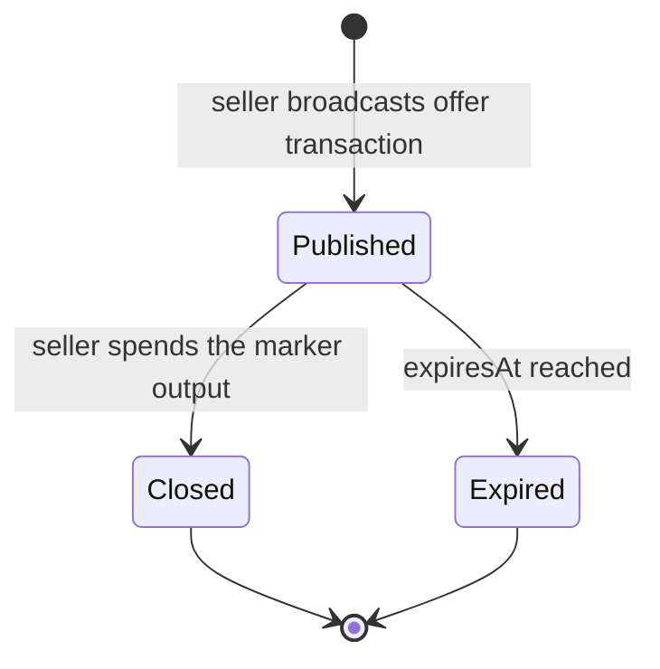
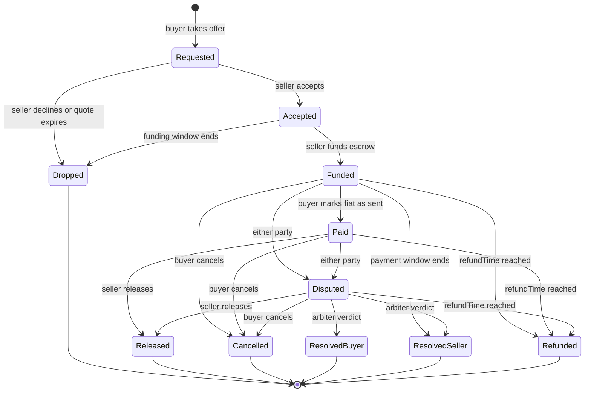
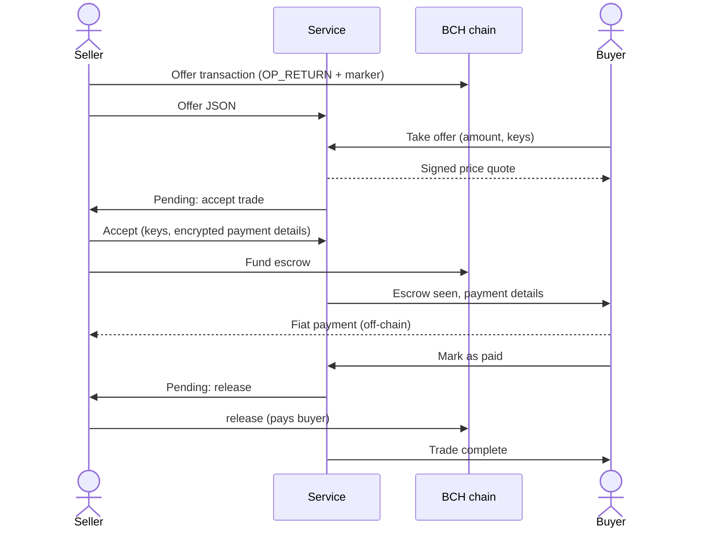
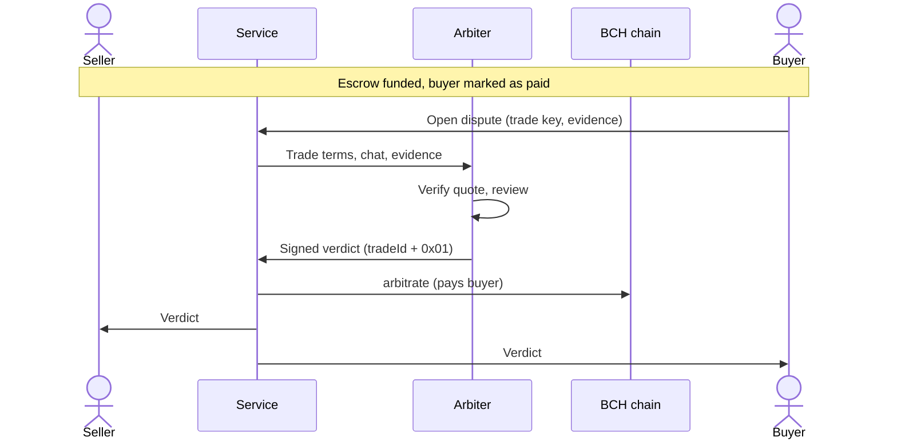
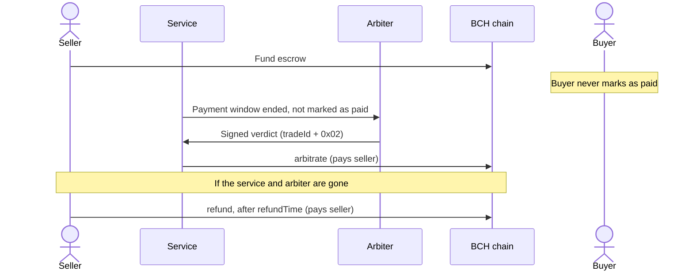

# Campfire protocol

Status: **approved design; escrow contract and demo seller implemented** · Format version: `1` · Last updated: 2026-11-16

Campfire is a non-custodial peer-to-peer exchange of BCH and CashTokens (PUSD first) for fiat money. This document specifies the offer format, the trade process and the escrow contract.

Everything described here targets Bitcoin Cash **mainnet**. The escrow contract is implemented in [`contracts/CampfireEscrow.cash`](../contracts/CampfireEscrow.cash).

## 1. Actors

| Actor | Role | Keys | Can move escrowed funds? |
| --- | --- | --- | --- |
| **Seller** | Publishes an offer, locks BCH or tokens in escrow, receives fiat off-chain, releases. | Wallet keys (via WizardConnect) | Only to the buyer (`release`) |
| **Buyer** | Takes an offer, pays fiat off-chain, receives the escrowed funds. | Wallet keys (via WizardConnect) | Only back to the seller (`cancel`) |
| **Arbiter** | Decides disputes. Signs a verdict, never a transaction. Named in the offer by public key. | One signing key | Only by choosing buyer or seller (`arbitrate`) |
| **Price oracle** | Signs exchange-rate quotes used by floating-price offers. Named in the offer by public key. | One signing key | No |
| **Service** | Web interface, API and database. Stores offers and trades created through the interface, relays chat, holds unsigned pending transactions. | None that control user funds | No |

For the hackathon the service also acts as the default arbiter and the default price oracle. These are separate roles identified by separate public keys, so a future offer can name any other arbiter or oracle.

### Keys

- **Wallet keys.** WizardConnect shares three extended public keys (`receive`, `change`, `defi`). The dapp derives public keys locally and the wallet keeps every private key. Each trade uses a fresh signing key from the `defi` path and a fresh payout address from the `receive` path.
- **Session keys.** A key pair generated in the browser for each trade. It is used only to encrypt payment details and chat (section 6). It has no authority over funds: losing it loses chat history, not money.
- **Service keys.** The arbiter key and the oracle key. They are kept as deployment secrets and never committed to the repository.

The service stores public keys and unsigned transactions only. It never stores a private key that can spend user funds.

### Identity and sign-in

Connecting a wallet with WizardConnect is the only sign-in. There are no accounts, passwords or e-mail addresses.

- A user's **identity** is the SHA-256 of the `defi` extended public key their wallet shares on connection. The same wallet yields the same identity on every visit.
- The service treats the extended public key presented by the client as the user, without a further proof of possession. This is acceptable because sign-in never controls funds: every movement of funds needs a wallet signature or an arbiter verdict.
- With the extended public key the service can check that the signing keys and payout addresses of a trade belong to that identity. It can therefore link all trades of one wallet, while those trades remain unlinked on-chain.

### Reputation

The service shows, for each identity, the number of completed trades as seller and as buyer and the date of the first one.

- A trade counts when its escrow was spent by `release`, or by `arbitrate` in favour of that party.
- A seller's trades are backed by the seller's own signatures (funding and release). A buyer signs nothing on the normal path, so a buyer's trades are backed only by the payout address belonging to the identity.
- The counter is computed and attested by the service. It cannot be recomputed from the chain by a third party, and a user can inflate it by trading with a second wallet of their own. The interface states this next to the number.

### The buyer needs no BCH

A buyer starts with an empty wallet. Nothing in the protocol requires the buyer to own BCH:

- taking an offer, marking a trade as paid and opening a dispute are off-chain;
- `cancel` is the only transaction a buyer signs, and its miner fee comes from the escrow's fee budget (section 5), not from the buyer;
- receiving the funds requires no action from the buyer's wallet.

## 2. Lifecycle

### 2.1 Offer



| Transition | Triggered by | Operation | Deadline |
| --- | --- | --- | --- |
| → Published | Seller | On-chain transaction with the offer `OP_RETURN` and a marker output (section 3) | — |
| Published → Closed | Seller | On-chain transaction spending the marker output | Any time |
| Published → Expired | Nobody | None; clients compare `expiresAt` with the current time | `expiresAt` |

Publishing an offer locks no funds. An offer with a `min`–`max` range can be taken many times, each time for an amount the buyer chooses within the range, until the seller closes it.

### 2.2 Trade



| Transition | Triggered by | Operation | Deadline |
| --- | --- | --- | --- |
| → Requested | Buyer | Off-chain: buyer sends amount, signing key, payout address and session key. For floating offers the oracle issues a signed quote. | Offer must be Published |
| Requested → Accepted | Seller | Off-chain: seller adds signing key, payout address and session key. The trade terms are now complete and `tradeId` is fixed (section 3.3). | Quote validity: 10 min |
| Accepted → Funded | Seller | **On-chain:** wallet pays the escrow address. | Funding window: 30 min |
| Funded → Paid | Buyer | Off-chain: buyer marks the fiat payment as sent. | Payment window from the offer (default 60 min) |
| Paid → Released | Seller | **On-chain:** `release`, signed by the seller, pays the buyer. | Before `refundTime` |
| Funded/Paid → Cancelled | Buyer | **On-chain:** `cancel`, signed by the buyer, pays the seller. | Before `refundTime` |
| Funded → ResolvedSeller | Arbiter | Off-chain verdict for the seller, issued automatically when the payment window ends and the buyer has not marked the trade as paid. **On-chain:** `arbitrate`. | End of payment window |
| → Disputed | Buyer or seller | Off-chain: the party opens a dispute and hands the chat key to the arbiter. | Any time after Funded |
| Disputed → Resolved* | Arbiter | Off-chain signed verdict. **On-chain:** `arbitrate`, broadcast by anyone. | Before `refundTime` |
| → Refunded | Anyone | **On-chain:** `refund` pays the seller. No signature needed. | From `refundTime` (acceptance + 14 days) |

States before Funded exist only in the service database. From Funded onward, the escrow UTXO is the source of truth and the service state is a convenience.

**Confirmations.** Campfire acts on the escrow deposit at zero confirmations (0-conf), protected by double-spend proofs (DSProofs). Payment details are revealed when the funding transaction reaches the mempool. The buyer's browser then asks its Electrum server for a DSProof of that transaction (`blockchain.transaction.dsproof.get`) and keeps asking until the deposit is in a block:

- No proof after 5 seconds in the mempool: the interface tells the buyer the deposit is safe at 0-conf and they can pay.
- A proof appears: the interface tells the buyer not to pay and disables "Mark as paid" until the deposit is confirmed.
- The check is unavailable: the interface asks the buyer to wait for one confirmation.

The same holds for the coins the buyer receives: the release is usable as soon as it reaches the network.

## 3. Offer format

### 3.1 Offer transaction

An offer is published by a transaction from the seller's wallet with these outputs:

| Output | Content |
| --- | --- |
| 0 | `OP_RETURN` with the fields below |
| 1 | Marker: 1,000 sats to a fresh address of the seller. The offer is open while this output is unspent. |
| 2 | Change (optional) |

`OP_RETURN` data pushes, in order:

| # | Field | Size (bytes) | Value |
| --- | --- | --- | --- |
| 1 | Protocol identifier | 4 | ASCII `CMPF` |
| 2 | Format version | 1 | `0x01` |
| 3 | Message type | 1 | `0x01` = offer |
| 4 | Arbiter public key | 33 | Compressed secp256k1 key |
| 5 | Oracle public key | 33 | Compressed secp256k1 key; 33 zero bytes for a fixed-price offer |
| 6 | Offer content hash | 32 | SHA-256 of the offer JSON bytes |

Total: about 110 bytes including push opcodes, within the 223-byte standardness limit for data outputs.

The offer is identified by the transaction ID of this transaction (`offerTxid`).

### 3.2 Offer JSON (version 1)

The JSON document carries everything that does not need to be on-chain. Its bytes are stored exactly as hashed; clients must verify the SHA-256 against the `OP_RETURN` before showing an offer. The hash is the digest of an IPFS CIDv1 (`raw` codec, `sha2-256`), so the same document can be pinned on IPFS without changing the on-chain record.

```json
{
  "v": 1,
  "side": "sell",
  "asset": "BCH",
  "assetDecimals": 8,
  "fiat": "ARS",
  "price": { "type": "floating", "pair": "BCH/ARS", "marginBps": 250 },
  "min": "100000",
  "max": "5000000",
  "paymentMethods": ["bank-transfer"],
  "paymentWindowSec": 3600,
  "terms": "Free text shown to the buyer before taking the offer.",
  "expiresAt": 1795000000,
  "arbiter": "02…",
  "oracle": "03…"
}
```

| Field | Type | Notes |
| --- | --- | --- |
| `v` | integer | Format version. Must equal the on-chain version. |
| `side` | string | Only `"sell"` in version 1. Reserved for buy offers. |
| `asset` | string | `"BCH"` or a 64-character token category ID in hex. |
| `assetDecimals` | integer | 8 for BCH, 2 for PUSD. |
| `fiat` | string | ISO 4217 currency code. |
| `price` | object | `{ "type": "fixed", "value": "<fiat per whole asset unit>" }` or `{ "type": "floating", "pair": "<ASSET/FIAT>", "marginBps": <integer> }`. The margin is in basis points over the oracle price and may be negative. |
| `min`, `max` | string | Amount range in base units of the asset (satoshis, or token base units). |
| `paymentMethods` | string array | Free identifiers; the actual account details are never in the offer. |
| `paymentWindowSec` | integer | Time the buyer has to mark the trade as paid after funding. |
| `terms` | string | Optional free text. |
| `expiresAt` | integer | Unix time. |
| `arbiter`, `oracle` | string | Must equal the on-chain keys. `oracle` is omitted for fixed-price offers. |

For the hackathon the service stores and serves this document by its hash. Pinning to public IPFS is future work (section 9).

### 3.3 Trade terms and `tradeId`

When the seller accepts, both clients hold the same trade-terms document:

```json
{
  "v": 1,
  "offerTxid": "…",
  "asset": "BCH",
  "amount": "250000",
  "fiat": "ARS",
  "fiatAmount": "1234.56",
  "quote": { "pair": "BCH/ARS", "price": "…", "timestamp": 1794900000, "signature": "…" },
  "marginBps": 250,
  "sellerPk": "…", "buyerPk": "…", "arbiterPk": "…", "oraclePk": "…",
  "sellerPayoutPkh": "…", "buyerPayoutPkh": "…",
  "sellerSessionPk": "…", "buyerSessionPk": "…",
  "refundTime": 1796109600,
  "nonce": "…"
}
```

`tradeId` = SHA-256 of these bytes. It is a constructor parameter of the escrow contract, so the escrow address commits to every term: the price, the oracle that signed it, the fiat amount and the session keys. Anyone holding the document can recompute the address and check it against the chain.

**Price quote.** For a floating offer, the oracle signs `SHA-256("CMPF-QUOTE" ‖ pair ‖ price ‖ timestamp)` with its key. Clients verify the signature against the oracle key in the offer before accepting. The contract does not verify the quote; it commits to it through `tradeId`, and the arbiter checks it in a dispute. For a fixed offer, `quote` is omitted and the price comes from the offer.

## 4. Escrow contract

One contract instance per trade, written in CashScript (`^0.14.0`), deployed as P2SH32.

### 4.1 Parameters

| Parameter | Type | Meaning |
| --- | --- | --- |
| `sellerPk` | `pubkey` | Seller's signing key for this trade |
| `buyerPk` | `pubkey` | Buyer's signing key for this trade |
| `arbiterPk` | `pubkey` | Arbiter's key, taken from the offer |
| `sellerPayoutPkh` | `bytes20` | Hash of the seller's payout key |
| `buyerPayoutPkh` | `bytes20` | Hash of the buyer's payout key |
| `tradeId` | `bytes32` | Hash of the trade terms |
| `refundTime` | `int` | Unix timestamp (`>= 500,000,000`) after which the seller can be refunded |

### 4.2 Payout rule

Every path pays the whole escrow UTXO to exactly one of the two payout addresses fixed in the contract. No signer chooses the destination. All paths enforce:

- the transaction has exactly one input and one output;
- output 0 is P2PKH to the path's payout hash;
- output 0 carries the same token category, token amount and NFT commitment as the escrow input;
- output 0 value ≥ escrow value − 1,000 sats (the maximum miner fee).

### 4.3 Spending paths

| Path | Pays | Requires | Used when |
| --- | --- | --- | --- |
| `release(sig)` | Buyer | Transaction signature by `sellerPk` | Seller confirms the fiat arrived |
| `cancel(sig)` | Seller | Transaction signature by `buyerPk` | Buyer gives up the trade |
| `arbitrate(datasig, verdict)` | Buyer if `verdict = 0x01`, seller if `0x02` | Data signature by `arbiterPk` over `tradeId ‖ verdict` | Dispute, or payment window expired |
| `refund()` | Seller | `tx.time >= refundTime` | Nothing else happened in 14 days |

Notes:

- `arbitrate` and `refund` need no wallet signature, so anyone can broadcast them. They can only pay the address fixed in the contract.
- The verdict is bound to one trade by `tradeId`, so it cannot be replayed on another escrow.
- The arbiter cannot take the funds: there is no path that pays a third address.
- **If the arbiter disappears**, `release` and `cancel` still work, so the parties can settle either way by agreement. If they do not agree, `refund` returns the funds to the seller at `refundTime`.
- `refund` favours the seller. A buyer who has paid must open a dispute well before `refundTime`.

Contract implementation ([`contracts/CampfireEscrow.cash`](../contracts/CampfireEscrow.cash)):

```cashscript
pragma cashscript ^0.14.0;

function requirePayout(bytes20 payoutPkh) {
    require(tx.inputs.length == 1, "only one input allowed");
    require(tx.outputs.length == 1, "only one output allowed");
    require(tx.outputs[0].lockingBytecode == new LockingBytecodeP2PKH(payoutPkh), "wrong payout address");
    require(tx.outputs[0].tokenCategory == tx.inputs[0].tokenCategory, "token category changed");
    require(tx.outputs[0].tokenAmount == tx.inputs[0].tokenAmount, "token amount changed");
    require(tx.outputs[0].nftCommitment == tx.inputs[0].nftCommitment, "NFT commitment changed");
    require(tx.outputs[0].value >= tx.inputs[0].value - 1000, "fee above 1000 satoshis");
}

contract CampfireEscrow(
    pubkey sellerPk,
    pubkey buyerPk,
    pubkey arbiterPk,
    bytes20 sellerPayoutPkh,
    bytes20 buyerPayoutPkh,
    bytes32 tradeId,
    int refundTime
) {
    function release(sig sellerSig) {
        requirePayout(buyerPayoutPkh);
        require(checkSig(sellerSig, sellerPk), "invalid seller signature");
    }

    function cancel(sig buyerSig) {
        requirePayout(sellerPayoutPkh);
        require(checkSig(buyerSig, buyerPk), "invalid buyer signature");
    }

    function arbitrate(datasig arbiterSig, bytes1 verdict) {
        require(verdict == 0x01 || verdict == 0x02, "unknown verdict");
        bytes20 winnerPkh = sellerPayoutPkh;
        if (verdict == 0x01) {
            winnerPkh = buyerPayoutPkh;
        }
        requirePayout(winnerPkh);
        require(checkDataSig(arbiterSig, tradeId + verdict, arbiterPk), "invalid arbiter verdict");
    }

    function refund() {
        requirePayout(sellerPayoutPkh);
        require(tx.time >= refundTime, "refund time not reached");
    }
}
```

### 4.4 Signing with WizardConnect

`release` and `cancel` are the only steps where a wallet signs a contract input. The dapp builds the transaction with a placeholder signature and sends it with `inputPaths = [[0, "defi", <index>]]`; the wallet fills in the signature using `SIGHASH_ALL | SIGHASH_FORKID | SIGHASH_UTXOS`. Support for placeholder signatures in contract inputs depends on the wallet and must be tested before anything else is built.

## 5. BCH and CashTokens

The same contract handles BCH and any CashToken, because the payout rule copies the token fields from input to output.

| | BCH trade | Token trade (PUSD) |
| --- | --- | --- |
| Escrow UTXO value | amount + 1,000 sats | 7,000 sats |
| Escrow UTXO tokens | none | amount, in token base units |
| Buyer receives | ≥ amount in BCH | the tokens, plus ≥ 6,000 sats |

- 1,000 sats of the escrow value is the fee budget for the spending transaction. Whatever is not used as fee goes to the recipient.
- A token escrow carries 6,000 sats besides the fee budget: 1,000 for the token output itself and 5,000 so that a buyer with no BCH can move the tokens afterwards. The contract rule is the same for both asset types; only the amount the seller funds differs.
- PUSD on mainnet: category `2469acc5afa4b10cb5b5c04afb89c3a3ffd61c5da9c01e26d00951cae2a02544`, 2 decimals.
- Before the buyer is told the escrow is funded, the client checks that a UTXO at the escrow address holds the exact value, category and token amount from the trade terms.
- Payout addresses for token trades are shown in the token-aware format (`bitcoincash:z…`).

## 6. Payment details and chat

| Data | Encrypted for | Stored where | Revealed when |
| --- | --- | --- | --- |
| Seller's payment details | Buyer's session key | Seller's browser; ciphertext on the service | When the funding transaction is seen |
| Chat messages | Shared trade key | Ciphertext on the service | Immediately, to the two parties |
| Chat, for the arbiter | — | — | Only when a party opens a dispute and hands over the trade key |

- Each party generates a session key pair in the browser when the trade starts. Both public keys are part of the trade terms, so they are committed by `tradeId`.
- The shared trade key is derived with ECDH from the two session keys and used with an authenticated symmetric cipher (AES-256-GCM).
- On acceptance, the seller's client encrypts the payment details for this trade and uploads the ciphertext. The service releases it to the buyer when it sees the funding transaction. Payment details are entered per trade and never appear in an offer.
- The service relays and stores ciphertext only. It can read a chat only after a party opens a dispute.

## 7. Sequence diagrams

### 7.1 Happy path



### 7.2 Dispute



### 7.3 Expiry



## 8. Demo mode

Goal: a judge alone completes a real trade on mainnet in a few minutes, from the web interface, without owning any funds.

- **Without a wallet** the judge can browse offers and past trades, with links to each transaction in a block explorer.
- **With a wallet** (WizardConnect, button at the top right) the judge takes an offer from the **demo seller**, a bot run by the service with its own small balance.
  1. The judge takes the bot's offer. The bot accepts and funds a real escrow on mainnet.
  2. The interface shows payment details clearly labelled as simulated. No fiat moves.
  3. The judge marks the trade as paid. The bot releases, and the judge receives real BCH (a few cents' worth).
- **Other paths the judge can trigger:**
  - *Cancel:* the judge cancels and signs; the funds go back to the bot.
  - *Expiry:* demo offers use a 5-minute payment window; if the judge does nothing, the arbiter verdict returns the funds to the bot.
  - *Dispute:* the judge opens a dispute and may then act as arbiter in a demo console that signs the verdict with the service arbiter key. This console only works for trades against the bot.
- **Offers:** the bot sells BCH and PUSD at a floating USD price from the oracle, with no margin, and uses `simulated` as its payment method.
- **Limits:** at most 20,000 sats or 0.10 PUSD per trade, at most 2 unfinished trades at a time and at most 10 trades funded per day, counted across all visitors. Limits per wallet would not help: a new wallet is a new identity (section 1).
- **Arbiter access:** the service arbiter key is the default arbiter of every offer, so its views and verdicts require an admin token. The demo console is the only exception: anyone may decide a disputed trade whose seller is the bot.
- **Honesty rule:** everything simulated carries a visible "simulated" label. On-chain steps are real and link to the explorer. The 14-day `refund` path cannot be shown live; the README links a real mainnet transaction for it instead.

Two wallets (or two people) can also trade with each other through the same interface; that is the product, not a demo mode.

## 9. Out of scope for the hackathon

- Chain-scanning indexer. The service records only offers and trades created through its own interface. The on-chain format already allows any indexer to rebuild the offer list.
- Pinning offer documents to public IPFS.
- Recovery of in-progress trades by a third-party indexer.
- Buy offers.
- Service or arbiter fees.
- Buyer deposit against malicious takes.
- Split verdicts (the arbiter can only choose one party).
- Reputation beyond the completed-trades counter (ratings, volume, distinct counterparties, resistance to self-trading).
- Proof of possession at sign-in (for example, signing a challenge transaction that is never broadcast).
- Privacy tools beyond one address per use.
- XO template.
- A market of independent arbiters and oracles (the format supports it; no interface for it).
- Chipnet deployment.
